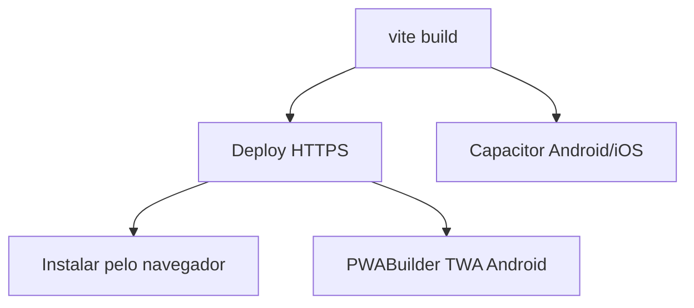

# Deploy e empacotamento — Protheus Connect (PWA)

Este guia cobre três caminhos:

1. **Deploy em produção (HTTPS)** — obrigatório para PWA e base dos outros
2. **PWABuilder (Android TWA)** — APK/AAB a partir da URL publicada
3. **Capacitor (Android / iOS)** — wrapper nativo para lojas



---

## 1. Deploy de produção (Docker)

O PWA é uma imagem multi-stage: Node 20 faz o build do Vite e o nginx 1.27 serve os arquivos estáticos na porta 80. As variáveis do Supabase entram no build (o bundle do Vite as embute).

Na raiz do repositório, com `VITE_SUPABASE_URL` e `VITE_SUPABASE_PUBLISHABLE_KEY` no ambiente ou num arquivo `.env` ao lado do compose:

```bash
docker compose up -d --build
```

A aplicação fica em `http://localhost:8080`. Em `protheus.oilema.tec.br` essa mesma imagem roda atrás do Caddy, no container `oilema-gestao-compra`.

## 2. Deploy de produção (Vercel)

### Pré-requisitos

- Conta na [Vercel](https://vercel.com)
- Repositório Git conectado
- Valores de `VITE_SUPABASE_URL` e `VITE_SUPABASE_PUBLISHABLE_KEY` (ver [apps/web/.env.production.example](apps/web/.env.production.example))

### Via CLI

Na raiz do monorepo (com `pnpm` disponível):

```bash
# Uma vez: login e link do projeto
npx vercel login
npx vercel link

# Produção
npx vercel --prod
```

Ou configure o projeto no dashboard da Vercel:

| Campo | Valor |
|-------|--------|
| Root Directory | `apps/web` |
| Framework Preset | Vite |
| Build Command | `cd ../.. && pnpm install && pnpm --filter @gestao-compra/web build` |
| Output Directory | `dist` |
| Install Command | `pnpm install` |

### Variáveis de ambiente (Vercel → Settings → Environment Variables)

```
VITE_SUPABASE_URL=https://SEU_PROJECT_REF.supabase.co
VITE_SUPABASE_PUBLISHABLE_KEY=sua_chave_publica
```

Marque **Production** (e Preview se quiser).

### SPA / PWA

O arquivo [apps/web/vercel.json](apps/web/vercel.json) já faz rewrite de todas as rotas para `index.html` (React Router).

Após o deploy, abra a URL HTTPS e valide:

1. Chrome DevTools → Application → Manifest + Service Workers
2. Lighthouse → Progressive Web App
3. Android: menu → **Instalar app**
4. iOS Safari: Compartilhar → **Adicionar à Tela de Início**

---

## 3. PWABuilder — pacote Android (TWA)

Gera APK/AAB que abre sua PWA em tela cheia (Trusted Web Activity).  
**Requer a URL de produção já no ar.**

### Passo a passo

1. Publique o site (seção 1).
2. Na pasta `apps/web`:

```bash
pnpm pwa:package -- https://SEU-DOMINIO.vercel.app
```

Isso abre o [PWABuilder Report Card](https://www.pwabuilder.com/) com o site.

3. No PWABuilder:
   - Corrija avisos de ícones/manifest se aparecerem
   - Em **Package for stores** → **Android**
   - Informe o package name (ex.: `br.com.oilema.protheusconnect` — mesmo do Capacitor)
   - Baixe o pacote (APK para teste ou AAB para Play Store)

4. **Digital Asset Links** (obrigatório para TWA “verified”):
   - Gere o fingerprint SHA-256 do certificado de assinatura (keytool / Play Console)
   - Copie [apps/web/public/.well-known/assetlinks.json.example](apps/web/public/.well-known/assetlinks.json.example) para `assetlinks.json`
   - Preencha `package_name` e `sha256_cert_fingerprints`
   - Faça redeploy para que fique em:
     `https://SEU-DOMINIO/.well-known/assetlinks.json`

5. Publique o AAB na [Google Play Console](https://play.google.com/console) ou distribua o APK internamente.

### Alternativa CLI (Bubblewrap)

Se preferir linha de comando em vez do site:

```bash
npx @bubblewrap/cli init --manifest https://SEU-DOMINIO/manifest.webmanifest
npx @bubblewrap/cli build
```

---

## 4. Capacitor — Android e iOS

Empacota o conteúdo de `dist/` em projetos nativos. Útil quando precisa de APIs nativas ou App Store.

### Pré-requisitos

| Plataforma | Requisitos |
|------------|------------|
| Android | [Android Studio](https://developer.android.com/studio), JDK 17+ |
| iOS | **macOS** + Xcode + conta Apple Developer |

### Instalação (já no package.json)

Na raiz do monorepo:

```bash
pnpm install
```

### Build + sync

```bash
cd apps/web
pnpm mobile:build
```

Isso roda `vite build` e `cap sync`.

### Adicionar plataformas (primeira vez)

```bash
cd apps/web
npx cap add android
# Somente em macOS:
npx cap add ios
```

Os diretórios `android/` e `ios/` estão no `.gitignore` (regeneráveis). Se preferir versioná-los, remova essas linhas do `.gitignore`.

### Abrir no IDE

```bash
pnpm cap:android   # Android Studio
pnpm cap:ios       # Xcode (macOS)
```

No Android Studio: **Build → Build Bundle(s) / APK(s)** ou **Generate Signed Bundle**.  
No Xcode: selecione o time de desenvolvimento e faça Archive para App Store Connect.

### Configuração

Arquivo: [apps/web/capacitor.config.ts](apps/web/capacitor.config.ts)

- `appId`: `br.com.oilema.protheusconnect` (altere se necessário)
- `appName`: Protheus Connect
- `webDir`: `dist`

Após cada mudança no front:

```bash
pnpm mobile:build
```

---

## Qual caminho escolher?

| Objetivo | Caminho |
|----------|---------|
| Uso interno, instalar pelo navegador | Só deploy HTTPS (seção 1) |
| Android na Play Store, site como fonte da verdade | PWABuilder / TWA (seção 2) |
| Android + iOS nas lojas, controle nativo | Capacitor (seção 3) |
| iOS App Store | Capacitor (PWA pura não entra na App Store) |

---

## Checklist rápido pós-deploy

- [ ] Site abre em HTTPS
- [ ] `/manifest.webmanifest` responde 200
- [ ] Service worker registrado (Application → Service Workers)
- [ ] Variáveis `VITE_SUPABASE_*` corretas no ambiente de produção
- [ ] Login e chamadas às Edge Functions funcionam
- [ ] (TWA) `/.well-known/assetlinks.json` válido
- [ ] (Capacitor) `pnpm mobile:build` + abrir Android Studio / Xcode
